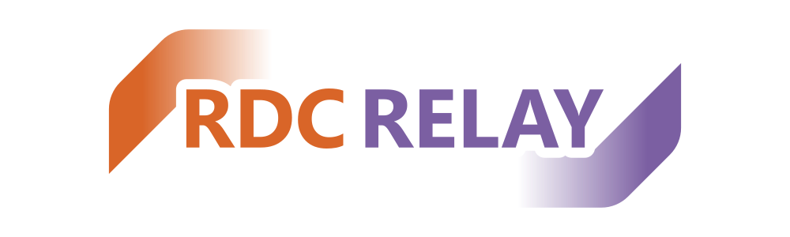

  

  <a href="README.md">English</a> | <b>Русский</b>

**RDC Relay — независимый программный супервизор Desktop Commander Remote для Windows.**

Приложение обеспечивает фоновое управление Remote и мониторинг состояния MCP-подключения для взаимодействия ИИ с компьютером без необходимости работы с терминалом.

## Основные возможности

- **Управление Remote** — запуск, остановка, переподключение и поддержание фоновой работы.
- **Автоматическое восстановление** — диагностика сбоев и восстановление подключения.
- **Мониторинг в реальном времени** — отображение состояния подключения, активности Remote, текущего аккаунта и оставшегося количества вызовов.
- **Смена аккаунта** — переключение между учётными записями Desktop Commander.
- **Управление из системного трея** — быстрый доступ к основным функциям.
- **Информативное журналирование** — преобразование технического потока событий Remote в компактный читаемый журнал с сохранением доступа к исходным логам.

## Установка

Актуальная версия RDC Relay доступна в разделе [Releases](https://github.com/Rubo-Facility/RDC-Relay/releases) в двух вариантах:

- **Setup** — стандартный установщик. При отсутствии необходимого окружения Node.js, npm и npx установщик предложит установить Node.js 24 LTS.
- **Portable** — портативная версия без установки. Полностью распакуйте ZIP-архив в локальную папку и запустите `RDC Relay.exe`.

> [!IMPORTANT]
> **Обновление с версии 1.6.0:** в связи с изменением адреса репозитория переход с версии 1.6.0 на более новые версии необходимо выполнить вручную, скачав актуальную версию из раздела [Releases](https://github.com/Rubo-Facility/RDC-Relay/releases).

> [!CAUTION]
> Установщик пока не имеет цифровой подписи. Windows SmartScreen может предупреждать о запуске программы, а Smart App Control — блокировать её запуск.

## Оригинальный проект

RDC Relay является независимым проектом и официально не связан с разработчиками Desktop Commander. Подключение устройства выполняется через официальный механизм подтверждения Desktop Commander; подтверждайте только знакомые вам устройства.

[Desktop Commander](https://github.com/wonderwhy-er/DesktopCommanderMCP)

[Журнал изменений](CHANGELOG.md)
